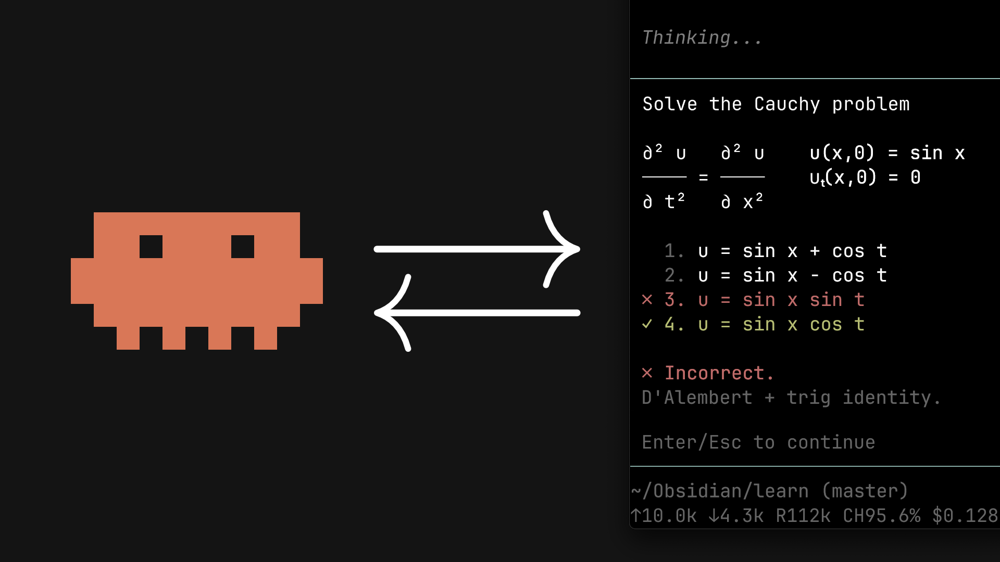

# learn

[](https://www.youtube.com/watch?v=kzcI5F4tGiU)

**A personal AI tutor that teaches you anything until you really understand it, and saves every lesson as notes you can reread.**

It runs inside **Claude Code** or **OpenCode** (AI assistants that run in a terminal window), and your lessons appear in **Obsidian** (a free note-taking app). You don't need to know how to code. If you can copy and paste, you can set this up.

It's based on the system from the video [How I Use AI to Learn Things](https://www.youtube.com/watch?v=kzcI5F4tGiU).

---

## Contents

1. [What it does](#what-it-does)
2. [What a lesson looks like](#what-a-lesson-looks-like)
3. [What you need](#what-you-need)
4. [Setup, step by step](#setup-step-by-step) (one time, about 20 minutes)
5. [Your first lesson](#your-first-lesson)
6. [Learning while you build something](#learning-while-you-build-something)
7. [Cheat sheet](#cheat-sheet)
8. [Tips for learning well](#tips-for-learning-well)
9. [Troubleshooting](#troubleshooting)
10. [Questions](#questions)
11. [For developers](#for-developers)

---

## What it does

Most AI chats *tell* you things, and you forget them by next week. This tutor works differently:

- **It finds out what you already know first.** It asks short quiz questions, getting harder until you miss one, so it knows exactly where your understanding ends.
- **It shows you a plan before teaching.** You get a small map of the ideas, from the basics up to your goal, and nothing starts until you say "OK".
- **It teaches one idea at a time, from the ground up.** It starts with facts that are simply true, then shows how each next idea follows from them, as if you could have discovered it yourself. Connected ideas stick; memorized facts fade.
- **It checks every step.** After each idea you get a quick multiple-choice question with instant feedback: ✓ right, ✗ wrong (with the correct answer and why), or "I don't know" (which is fine and never counts against you).
- **It checks its own facts.** When the tutor isn't sure of something, it sends a helper to research it on the web before telling you.
- **It draws diagrams when a picture helps**, and checks each diagram is correct before showing it.
- **It saves everything into Obsidian**: your questions, the explanations, every quiz and your answers, as a nicely formatted note you can reread anytime.

---

## What a lesson looks like

```
You:    /teach how the internet works

Tutor:  (asks a few quick quiz questions to find your level)
        (asks what exactly you want to understand)

Tutor:  Here's the plan: we start from "all data travels as small packets",
        then build up to how a web page reaches you.
        [small map of the ideas]
        Does this plan look right?

You:    Yes

Tutor:  (teaches the first idea → quick quiz → next idea → quiz → ...)
```

Meanwhile, in Obsidian, a note like `lessons/2026-10-12-how-the-internet-works.md` fills up with the whole lesson as it happens.

---

## What you need

| What | Why | Cost |
|---|---|---|
| A Mac, Windows or Linux computer | To run everything | — |
| [Obsidian](https://obsidian.md) | Where you read your lessons | Free |
| [Node.js](https://nodejs.org) | A small engine the tools need in the background | Free |
| **One** AI assistant: **Claude Code** *or* **OpenCode** | The tutor itself | See below |

**Which AI assistant?**

- **Claude Code** is made by Anthropic and uses Claude. You need a paid Claude plan (Pro or Max) or an Anthropic API account.
- **OpenCode** is open source and works with many AI models, including Muse Spark. You connect it to a model provider: some are free, some paid.

Not sure? Pick **Claude Code** if you already pay for Claude. Pick **OpenCode** if you want to choose your own model or try free ones. Everything in this project works with both.

---

## Setup, step by step

You only do this once. Take it slowly; each step is short.

### Step 1: Install Obsidian

1. Go to [obsidian.md](https://obsidian.md) and download it.
2. Install it like any other app. You'll open it again in Step 7.

### Step 2: Install Node.js

1. Go to [nodejs.org](https://nodejs.org) and download the version marked **LTS** (the recommended one).
2. Run the installer and click through with the default options.

### Step 3: Open a terminal

A **terminal** is a window where you type commands instead of clicking. You'll only need a few, and you can copy and paste all of them.

- **Mac:** press **Cmd + Space**, type `Terminal`, press **Enter**.
- **Windows:** press the **Windows key**, type `PowerShell`, press **Enter**.

To check Node.js installed correctly, paste this into the terminal and press **Enter**:

```bash
node --version
```

You should see a version number like `v22.11.0`. If you see "command not found", close the terminal, open a new one, and try again. If it still fails, repeat Step 2.

> **How to paste in a terminal:** Mac: **Cmd + V**. Windows PowerShell: **Ctrl + V** or right-click.

### Step 4: Install your AI assistant

Choose **one**. Paste its command into the terminal and press **Enter**.

**Option A: Claude Code**

```bash
npm install -g @anthropic-ai/claude-code
```

**Option B: OpenCode**

```bash
npm install -g opencode-ai
```

It takes a minute. When the terminal shows a new empty line where you can type, it's done. (On a Mac, if you see a "permission denied" error, see [Troubleshooting](#troubleshooting).)

### Step 5: Download this project

**The easy way (no Git needed):**

1. At the top of this page on GitHub, click the green **Code** button.
2. Click **Download ZIP**.
3. Unzip the file (double-click it). You get a folder called `learn-main`.
4. Move that folder somewhere you'll find it again, for example into **Documents**. You can rename it, e.g. to `my-learning`.

**The Git way (if you know Git):**

```bash
git clone https://github.com/okaytu/learn my-learning
```

### Step 6: Go into the folder and install the diagram helper

Now tell the terminal to work inside your project folder. This is called "going into" the folder.

- **Mac:** type `cd` followed by a space, then **drag the folder from Finder into the terminal window**. The folder's location appears. Press **Enter**.
- **Windows:** open the folder in File Explorer, click the address bar at the top, type `powershell`, press **Enter**. A new PowerShell window opens already inside the folder.

Then paste this and press **Enter**:

```bash
npm install
```

This installs the tool that draws diagrams (and a small browser it uses to draw them). It takes a minute or two. Warnings in yellow are normal; only red "ERR!" lines are a problem.

### Step 7: Open the folder in Obsidian

1. Open Obsidian.
2. Choose **Open folder as vault**.
3. Pick your project folder (e.g. `my-learning`).
4. If Obsidian asks whether to trust the folder, choose **Trust**.

You'll see folders like `lessons` and `viz`. That's where your notes and diagrams will appear. Hidden folders (starting with a dot) hold the system itself; you don't need to touch them.

**Hide the helper folders from Obsidian** (recommended). `npm install` added a big `node_modules` folder full of technical files you'll never read. To keep them out of your search and graph:

1. In Obsidian, open **Settings** (the gear icon, bottom left).
2. Go to **Files and links** → **Excluded files** → **Manage**.
3. Add these three, one at a time: `node_modules/`, `src/`, `scripts/`.

> **Already have an Obsidian vault you want to use?** Put the project folder *inside* your vault instead (e.g. `My Vault/learn/`) and skip "Open folder as vault". Everything works the same, with two differences: in Excluded files, add `learn/node_modules/`, `learn/src/` and `learn/scripts/` (use your folder's name), and always start the tutor from inside that `learn` folder, not from the vault's top folder. Your lessons appear in `learn/lessons/`, and you can link to them from any of your other notes.

### Step 8: Start the tutor for the first time

In the terminal (still inside your project folder), type:

- **Claude Code:** `claude` and press **Enter**.
- **OpenCode:** `opencode` and press **Enter**.

**First-time setup:**

- **Claude Code** opens your browser so you can log in with your Claude account. Then it asks whether you trust the files in this folder: choose **Yes**. The tutor needs this to save your lesson notes.
- **OpenCode:** type `/connect`, press **Enter**, pick a provider, and follow the steps to sign in or paste a key. Then type `/models` and pick a model (e.g. Muse Spark). OpenCode remembers it.

🎉 You're set up. From now on you only need Step 8: open a terminal in the folder and type `claude` or `opencode`.

---

## Your first lesson

1. Arrange your screen with **Obsidian on one side** and the **terminal on the other**.
2. In the terminal, type `/teach` followed by what you want to learn, and press **Enter**:

   ```
   /teach how compound interest works
   ```

3. **Answer the warm-up questions.** A box pops up with options. Use the **arrow keys** to move and **Enter** to choose. Be honest: picking "I don't know" helps the tutor more than guessing.
4. **Say what you're after.** The tutor asks what you want to get out of it. Answer in your own words.
5. **Check the plan.** You'll see a short plan and a map of the ideas. If it's too basic, too advanced, or missing something you care about, say so. When it looks right, say **yes**.
6. **Learn.** The tutor teaches one idea, then quizzes you on it. Read each explanation, answer each quiz, and ask questions anytime by just typing them.
7. **Read along in Obsidian.** The tutor tells you which note it's saving the lesson to. Open it from the `lessons` folder in Obsidian; it updates as you go.

**To stop:** just stop. Your notes are already saved. To quit the AI assistant, type `/exit` or press **Ctrl + C** twice.

**To continue later:** start it again and say e.g. *"Let's continue the compound interest lesson. My notes are in lessons/2026-10-12-compound-interest.md."*

---

## Learning while you build something

If you're making something with the AI (a website, a spreadsheet script, a small app) and want to **learn as you go** instead of just getting it done for you, turn on **Mentor mode**:

- **Claude Code:** type `/config`, go to **Output style**, choose **Mentor**.
- **OpenCode:** press the **Tab** key until the bottom bar shows **mentor**.

In Mentor mode the AI still does the work, but it:

- explains **why** it chose each approach, in a sentence or two;
- leaves **one small piece for you to write**, marked `TODO(learner)`, then reviews what you wrote (say "just do it" if you're in a hurry);
- ends each task with a short **"What just happened"** summary, sometimes with one quiz question.

To keep the session in Obsidian too, type `/md-log` (see the cheat sheet).

---

## Cheat sheet

Type these in the AI assistant:

| Type this | What it does |
|---|---|
| `/teach <topic>` | Start a full lesson on a topic |
| `/md-log` | Start saving this conversation into a note in `lessons/` |
| `/md-log lessons/my-note.md` | Save into a note with the name you choose |
| `/md-unlog` | Stop saving into the note |
| `/config` → Output style → Mentor | Claude Code: turn Mentor mode on (choose Default to turn it off) |
| **Tab** | OpenCode: switch between normal mode and Mentor mode |
| `/exit` | Quit |

You can also just talk normally: *"Quiz me on what we covered"*, *"Explain that again more simply"*, *"Draw a diagram of that"*, *"Slow down"*, *"Skip ahead, I know this part"*.

---

## Tips for learning well

- **Be honest in quizzes.** Choose "I don't know" rather than guess. The tutor uses your answers to decide what to teach.
- **Say when something feels arbitrary.** "Why does it have to be that way?" is the best question you can ask. The whole method is built around answering it.
- **Push back on the plan.** It's cheap to change before the lesson starts.
- **Keep sessions short.** 30–45 minutes of real focus beats 2 hours of skimming.
- **Reread your notes the next day.** Obsidian has them all, with diagrams, in one place.
- **Make it yours.** The way the tutor teaches is written in plain English in `.claude/skills/teach/SKILL.md`. You can open it in any text editor and change it. See [For developers](#for-developers).

---

## Troubleshooting

**"command not found: node", "npm", "claude" or "opencode"**
Close the terminal and open a new one; a fresh window picks up new installs. If it still fails, reinstall the missing piece (Step 2 for node/npm, Step 4 for claude/opencode).

**"Unknown command: /teach"**
The tutor was started from the wrong folder, so it can't find its setup. Type `/exit`, then go into the project folder (Step 6) and start `claude` or `opencode` again. To check you're in the right place before starting, type `ls -a` (Mac) or `ls -Force` (Windows): you should see `.claude` and `.opencode` in the list. If they're missing, you're in the wrong folder, or the download is incomplete, so download the ZIP again.

**Mac: "permission denied" (EACCES) during Step 4**
Run this once, then repeat Step 4:
```bash
mkdir -p ~/.npm-global && npm config set prefix ~/.npm-global && echo 'export PATH=~/.npm-global/bin:$PATH' >> ~/.zshrc && source ~/.zshrc
```

**Windows: "running scripts is disabled on this system"**
Run this once in PowerShell, answer `Y`, then try again:
```powershell
Set-ExecutionPolicy -Scope CurrentUser RemoteSigned
```

**The lesson note in Obsidian stays empty**
- Make sure you started `claude` or `opencode` **inside the project folder** (Step 6 explains how to get there).
- Claude Code: make sure you answered **Yes** when it asked whether to trust the folder.
- The note updates at the end of each reply, so give it a moment.

**Diagrams don't appear**
- Make sure you ran `npm install` inside the project folder (Step 6).
- In Obsidian, diagrams live in the `viz` folder. If you moved things around, keep `viz` inside the vault.
- OpenCode: the model you picked must be able to "see" images (Muse Spark can). The diagram helper looks at each picture to check it.

**OpenCode can't search the web**
On OpenCode's own providers this works automatically. With other providers, start OpenCode like this instead:
```bash
OPENCODE_ENABLE_EXA=1 opencode
```
On Windows PowerShell: `$env:OPENCODE_ENABLE_EXA=1; opencode`

**I see the old pi logo in the picture at the top**
Your browser shows an old copy. Refresh with **Cmd + Shift + R** (Mac) or **Ctrl + F5** (Windows), or download the project again.

---

## Questions

**Do I need to know how to code?**
No. You type in plain language. The commands in this guide are the only "code" you'll ever need, and you can copy all of them.

**How much does it cost?**
This project is free. You pay only for the AI: a Claude plan for Claude Code, or whatever your OpenCode provider charges (some models are free).

**Can I use Muse Spark?**
Yes, in OpenCode: type `/models` and pick it. The helpers (researcher, diagram makers) automatically use the same model. Third-party reports say the **free** "Contributor" access to Muse Spark may use your conversations to train future models ([source](https://select.keenable.ai/r/opencode-go-25-model-price-throughput-capability-guide/JCZU0lc6y3CWlMKZRnGI0Q), [source](https://www.mydealz.de/deals/muse-spark-13-kostenlos-nutzbar-uber-opencode-vgb-mit-opus-5-gpt-56-sol-2834571)). That's fine for learning, but don't share private information there, and check the current terms on OpenCode's site.

**Where are my notes stored?**
On your computer, in the `lessons` folder of your project. Diagrams are in `viz`. They're normal files: you can back them up, sync them, or move them like any other.

**Can I learn things that aren't about computers?**
Yes: math, history, biology, economics, music theory, anything. Math formulas display properly in Obsidian.

**Is the tutor always right?**
It's designed to check facts it's unsure about before teaching them, but no AI is perfect. If something seems off, ask *"Are you sure? Please check that."*

---

## For developers

<details>
<summary>How it works, file layout, and customizing (click to open)</summary>

### Overview

A port of [amosblomqvist/learn](https://github.com/amosblomqvist/learn) from pi to Claude Code and OpenCode. The teaching philosophy (skills) is unchanged; pi's extensions are replaced by each harness's built-in tools plus a few small shared Node scripts.

| Piece | Claude Code | OpenCode |
|---|---|---|
| `teach`, `visualize` skills | `.claude/skills/` | Same files (OpenCode reads `.claude/skills/`) |
| `researcher`, `mermaid-maker`, `svg-maker` subagents | `.claude/agents/` | `.opencode/agents/` |
| Mentor mode | `.claude/output-styles/mentor.md` | `.opencode/agents/mentor.md` (primary agent) |
| Quizzes and questions | Built-in `AskUserQuestion` | Built-in `question` tool |
| Lesson log | Hooks in `.claude/settings.json` → `scripts/md-log.mjs` | Plugin `.opencode/plugins/md-log.ts` |
| Commands | `.claude/commands/` (`/md-log`, `/md-unlog`; `/teach` is the skill) | `.opencode/commands/` (`/md-log`, `/md-unlog`, `/teach`) |
| Project instructions | `CLAUDE.md` (imports `AGENTS.md`) | `AGENTS.md` |

### Layout

```
AGENTS.md, CLAUDE.md     project instructions for the agent
.claude/                 skills, generated agents, output style, commands, hooks
.opencode/               generated agents, commands, md-log plugin
src/                     source of every agent prompt and of mentor mode
scripts/
  build.mjs              generates .claude/agents, .opencode/agents and the output style from src/
  render.mjs             Mermaid/SVG → PNG for the diagram makers (preview, or --publish)
  md-log.mjs             CLI (link/unlink/status) + Claude Code hook entry point
  md-log-core.mjs        shared state + Obsidian callout formatting
lessons/                 lesson notes (written by md-log)
viz/                     published diagrams (written by the makers)
.learn/                  git-ignored scratch: log cursor, diagram drafts, previews
```

### The lesson log

`node scripts/md-log.mjs link <note.md>` stores the target in `.learn/md-log.json`. The first session to fire an event afterwards claims it and backfills; other sessions are ignored. It's append-only and never overwrites a note.

- **Claude Code:** the `hook` subcommand runs on `PreToolUse`/`PostToolUse` for `AskUserQuestion` (question written before the answer, answer right after) and on `Stop`. Each run reads the session transcript from the last cursor.
- **OpenCode:** the plugin syncs on `session.idle` and around the `question` tool via `client.session.messages`, and skips subagent sessions.

### Diagrams

The makers write `.learn/work/<slug>.{mmd,svg}`, run `node scripts/render.mjs <file>` to get `.learn/preview/<slug>.png`, look at it with their read tool, iterate, then `--publish <slug>` to copy it to `viz/viz-<slug>-<timestamp>.png`. Mermaid renders via `@mermaid-js/mermaid-cli` (a found Chrome/Chromium, or puppeteer's own). SVG renders via `rsvg-convert`, then ImageMagick, then headless Chrome.

### Customizing

- **Teaching style:** edit `.claude/skills/teach/SKILL.md` (and `visualize/SKILL.md`). No build step.
- **Agents and Mentor mode:** edit `src/agents/*.md` or `src/mentor.md`, then run `npm run build`. `npm run check` exits non-zero if the generated files are stale. Never edit the generated files directly.
- **Models:** Claude Code agents use the `sonnet` alias (set in `scripts/build.mjs`). OpenCode agents pin no model, so they inherit the session's; add `model` under `opencode` for an agent in `scripts/build.mjs` to pin one.
- **Permissions:** `.claude/settings.json` pre-allows the two scripts plus web search and fetch; `opencode.json` allows `question` and `webfetch`. The OpenCode makers may only run `node scripts/render.mjs *` in bash.

### Requirements

Node 18+. Optional: `librsvg` for SVG rendering (`brew install librsvg` / `apt install librsvg2-bin`), and `PUPPETEER_EXECUTABLE_PATH` to point at a specific Chrome.

</details>

---

## Credits

Teaching system and philosophy from [amosblomqvist/learn](https://github.com/amosblomqvist/learn) and the video [How I Use AI to Learn Things](https://www.youtube.com/watch?v=kzcI5F4tGiU). Ported to Claude Code and OpenCode in this repository.
